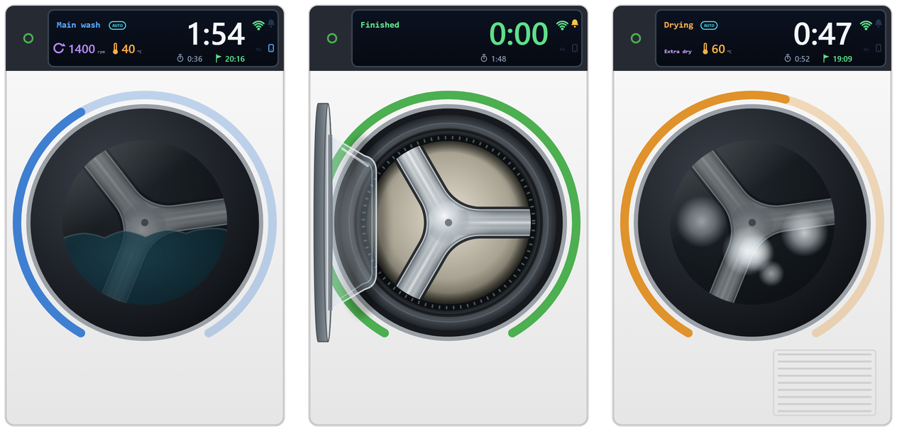
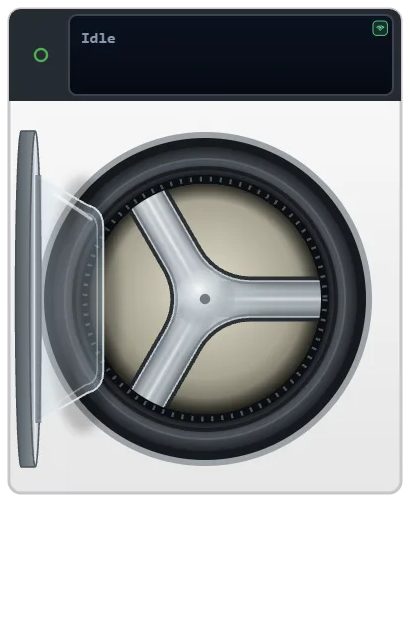
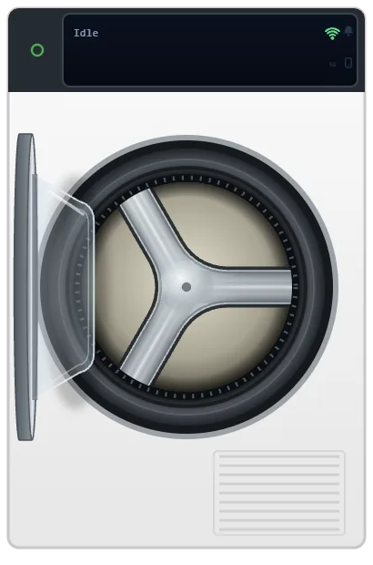
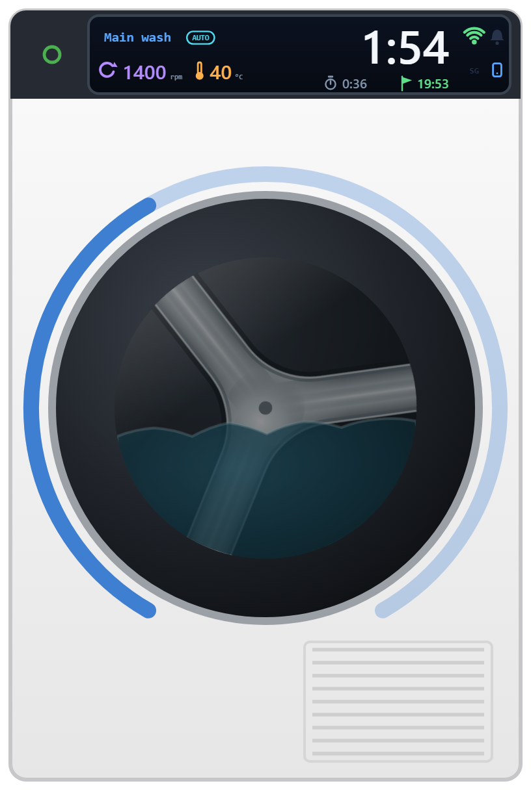
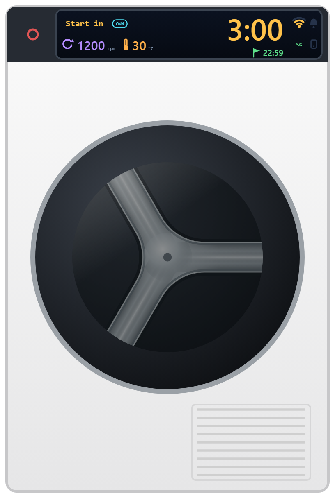
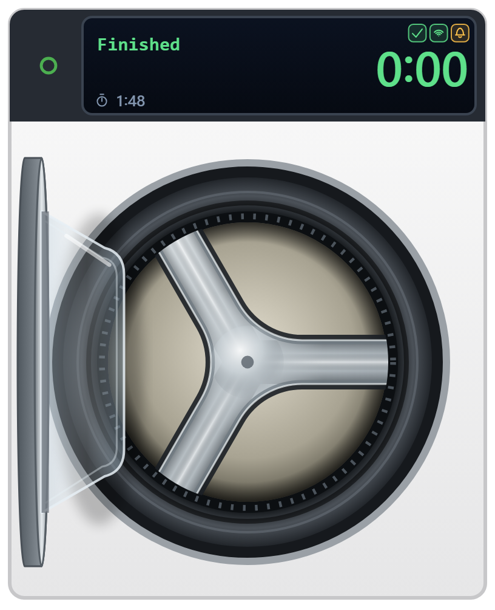
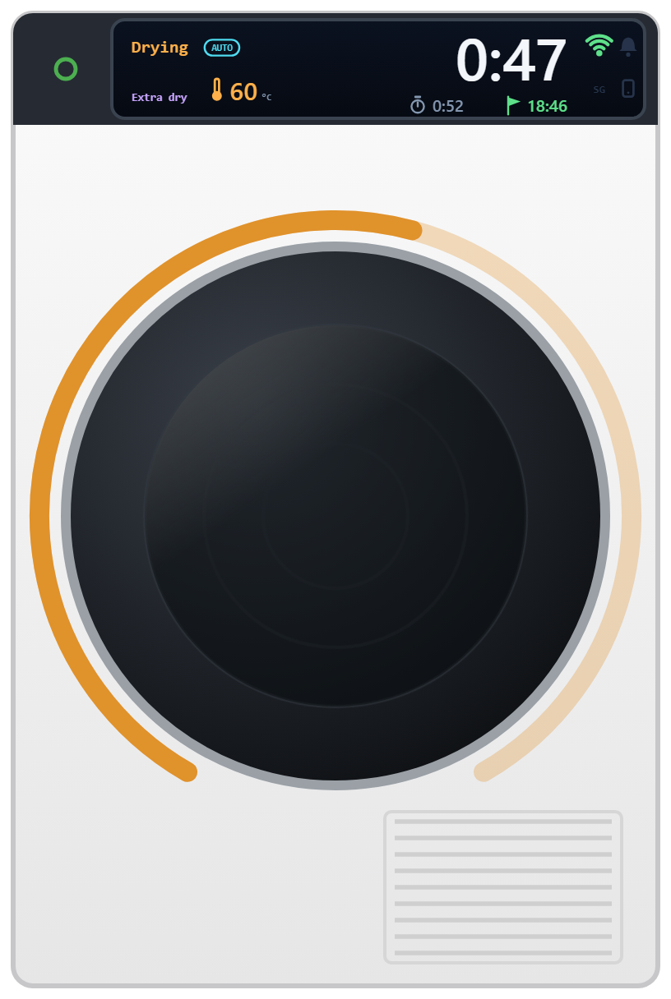
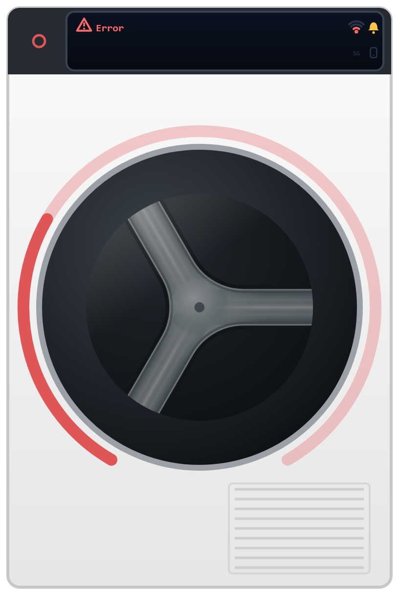
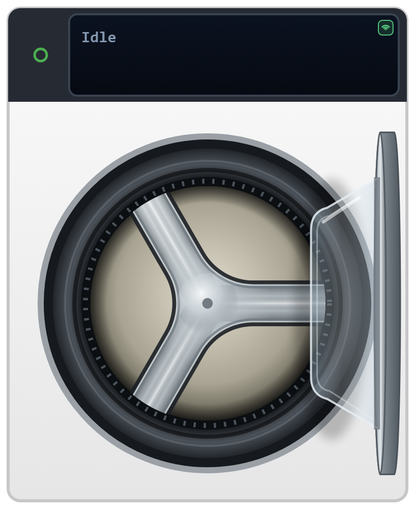

<p align="center">
  
</p>

<h1 align="center">Appliance Card</h1>

<p align="center">
  A Lovelace card for a <b>washer</b> or <b>tumble dryer</b>, drawn like a real front panel:
  animated drum, an opening door and a colour LCD with the program, time, spin speed and temperature.
</p>

<p align="center">
  
</p>

The card is not tied to a brand or an integration: pick a **device** and it finds the entities by role, or set
each entity yourself. It was built for Miele appliances through
[ha-miele-cloud](https://github.com/dimabutenko/ha-miele-cloud) and also works with the older
[`miele_lan`](https://github.com/tiehfood/ha-miele-at-lan). There is no title and no visible container: the appliance
itself is the card. No brand marks, shapes only.

## Features

- **Washer and dryer** from the same card (`appliance: washer | dryer`), each with its own drum behaviour and its own LCD.
- **Animated drum.** The same three-armed crosspiece in both appliances. The washer turns it slowly under a
  settling, splashing water pool, then fast and bare during spin. The dryer turns it dry, with steam rising
  from the load. There is no vent grille: the front is cut short, the drum sits high.
- **Any integration.** A device picker (or a prefix, or entity by entity) wires the roles; statuses, programs and
  phases are normalised.
- **Real program flow.** Water, steam, rotation speed, the colour of the progress arc and the LCD all follow the
  appliance's phase, and everything stops as soon as the door opens.
- **A door that really opens.** When the door sensor reports open, the door swings out (hinge left or right) with
  its deep glass bowl, and you look into the drum. Nothing turns while it is open.
- **Progress arc** around the door, coloured per program phase, keeping a coloured history of each phase.
- **Colour LCD** with the program (with a thumbnail) and its current phase, a big time, elapsed and finish time, spin
  speed, temperature, TwinDos doses and a row of status tiles that only shows what is lit. Hover any icon for a tooltip.
- **Program thumbnails.** About 70 programs of the washer and the dryer, drawn as small vector tiles
  (cottons, delicates, woollens, quick, eco, sportswear, duvets, ...).
- **TwinDos** (washers that have it): how much each bottle takes in this wash, and a tile that lights up when a bottle
  is low or empty.
- **Translations** (English by default, Russian included) in plain files that are easy to extend.

## Animations

These are recordings of the real card running a whole program on a fake clock (10 simulated minutes per second),
so the countdown moves. This is what you will see on your dashboard.

| Washer: door open → close → wash → rinse → spin → finished → door open | Dryer: door open → close → drying with steam → finished → door open |
|:---:|:---:|
|  |  |

What moves, and when:

| Animation | When |
|---|---|
| Crosspiece turns slowly, water slops and splashes | Washer, any phase except spin and drain |
| Crosspiece spins fast, no water | Washer, spin and drain |
| Crosspiece turns, steam rises and fades | Dryer, while running |
| Progress arc fills, each phase in its own colour | Whenever a program has progress |
| Door swings open or closed, drum area switches to the inside of the drum | The door sensor changes |
| Colon in the time blinks, the time counts down on its own | While running, driven by `finish_time` |
| Everything in the drum stops | Door open, or the machine is not running |

## Screenshots

| Washing | Delayed start | Finished, door open |
|:---:|:---:|:---:|
|  |  |  |

| Dryer | Error | Door hinge on the right |
|:---:|:---:|:---:|
|  |  |  |

## Installation

### HACS

HACS → ⋮ → *Custom repositories* → add `https://github.com/dimabutenko/ha-miele-appliance-card` with type
*Dashboard* (Lovelace), then download **Appliance Card**. The repository and the file keep their old name
(`miele-appliance-card.js`), so existing dashboard resources keep working.

### Manual

1. Download `miele-appliance-card.js` from the latest [release](https://github.com/dimabutenko/ha-miele-appliance-card/releases/latest)
   and copy it to `/config/www/community/miele-appliance-card/`.
2. Add it as a dashboard resource (Settings → Dashboards → ⋮ → Resources → Add resource):
   `/local/community/miele-appliance-card/miele-appliance-card.js`, type *JavaScript Module*.

## Configuration

The card has a visual editor. The card type is `custom:home-appliance-card` (the old `custom:miele-appliance-card`
still works).

There are three ways to tell the card where its entities are, and they can be combined (the most specific wins):

1. **`device`**: the id of a device. Every entity of the device is looked at and matched to a role by its
   translation key or by the tail of its entity id (`..._remaining_time`, `..._end_time`, ...). In the editor this is
   a normal device picker.
2. **`prefix`**: the entity ids share a prefix: `sensor.<prefix>_status`, `binary_sensor.<prefix>_door`, ...
3. **`entities`**: one entity per role. Wins over both of the above, so it can fix a single role or build the whole
   card by hand.

```yaml
type: custom:home-appliance-card
appliance: washer # or dryer
device: 0123456789abcdef0123456789abcdef # the easiest: all entities of the device
door_hinge: left # optional: left | right
language: en # optional: en | ru. Default: the Home Assistant language, falls back to en
```

```yaml
# or, entity by entity (every role is optional; what is missing is simply not shown)
type: custom:home-appliance-card
appliance: dryer
entities:
  status: sensor.dryer_status
  phase: sensor.dryer_phase
  remaining: sensor.dryer_remaining
  door: binary_sensor.dryer_door
```

| Option | Default | Meaning |
|---|---|---|
| `appliance` | `washer` | `washer` or `dryer`: picks the silhouette, the drum and the LCD |
| `device` | – | Device id; its entities are picked up by role |
| `prefix` | – | Shared prefix of the entity ids |
| `entities` | – | Per-role entities (see below) |
| `door_hinge` | `left` | Which side the door is hinged on, when it is shown open |
| `language` | auto | `en` or `ru` |
| `debug` | `false` | Line 2 of the LCD shows the raw program value |
| `program_names` | – | Override program texts, e.g. `gentle_smoothing: Bed linen` |

### Roles

Every role is optional: anything missing is simply not shown. With `device`, a role is also found under the
alternative names listed.

| Role | Entity (with `prefix`) | Other names | Used for |
|---|---|---|---|
| `running` | `binary_sensor.<prefix>_running` | | drum animation, ring, power button |
| `finished` | `binary_sensor.<prefix>_finished` | `program_finished` | the program is over though the appliance still says "in use" (a dryer's crease guard): shows "Finished" |
| `failure` | `binary_sensor.<prefix>_failure` | | error on the LCD |
| `door` | `binary_sensor.<prefix>_door` | | opens the door |
| `status` | `sensor.<prefix>_status` | | status tile and line (paused, finished, start in ...), screen off when the machine is off |
| `phase` | `sensor.<prefix>_program_phase` | `phase` | current phase line and ring colour |
| `program_id` | `sensor.<prefix>_program_id` | `program` | program name and thumbnail |
| `progress` | `sensor.<prefix>_progress` | | progress ring |
| `remaining` | `sensor.<prefix>_remaining` | `remaining_time` | big time |
| `elapsed` | `sensor.<prefix>_elapsed` | `elapsed_time` | elapsed time |
| `start_in` | `sensor.<prefix>_start_in` | | big time while waiting for a delayed start (minutes) |
| `start_time` | `sensor.<prefix>_start_time` | `delayed_start` | the same as a timestamp |
| `finish_time` | `sensor.<prefix>_finish_time` | `end_time` | finish time, live countdown |
| `target_temperature` | `sensor.<prefix>_target_temperature` | | temperature |
| `standby` | `sensor.<prefix>_standby_state` | `standby` | screen off in deep standby |
| `wifi` | `sensor.<prefix>_wifi_signal` | `wifi` | Wi-Fi tile (percent or dBm); not drawn without this role |
| `notification` | `binary_sensor.<prefix>_notification` | | bell tile |
| `smart_grid` | `binary_sensor.<prefix>_smart_grid` | | lightning tile |
| `mobile_start` | `binary_sensor.<prefix>_mobile_start` | | phone tile |
| `spin_speed` | `sensor.<prefix>_spin_speed` | | spin speed (**washer only**) |
| `twindos_1_level`, `twindos_2_level` | `sensor.<prefix>_twindos_N_level` | | fill level of a TwinDos bottle (**washer only**) |
| `twindos_1_dosage`, `twindos_2_dosage` | `sensor.<prefix>_twindos_N_dosage` | | millilitres this wash takes from a bottle (**washer only**) |
| `twindos_1_empty`, `twindos_2_empty` | `binary_sensor.<prefix>_twindos_N_empty` | | a bottle is empty (**washer only**) |
| `drying_step` | `sensor.<prefix>_drying_step` | `drying_level` | drying step (**dryer only**) |

### What the sensors may contain

The card understands the statuses, programs and phases of different integrations:

- **status**: `in_use`, `pause`, `waiting_to_start`, `program_ended` (also `end_of_cycle`), `off`, ...
- **program** and **phase**: either a snake_case key (`cottons`, `main_wash`) or human text. With text, an attribute
  `program_key` / `phase_key` on the entity carries the key (the card uses it for the thumbnail, the colour and its own
  translations, and shows the integration's text when it has no translation of its own).

## Reading the LCD

| Where | What |
|---|---|
| Top left | The program: a thumbnail, its name and, under it, the current phase (the phase pulses while the program runs) |
| Row of tiles, top right | Only what is lit, packed to the right. See below |
| Right, big | Time left, or the time until a delayed start |
| Bottom row | Groups separated by thin bars: spin speed, temperature, TwinDos doses (a drop with the bottle number and the ml this wash takes), elapsed time (stopwatch), expected finish (flag) |
| Red `Error` | The appliance reports a failure |

Tiles, left to right (a tile appears only when it has something to say):

| Tile | Meaning |
|---|---|
| ▶ ⏸ clock ✓ | Status: running, paused, waiting for a delayed start, finished |
| Drop with 1 or 2 | TwinDos bottle 1 / 2 is low (20 % or less, amber) or empty (red) |
| Wi-Fi | Signal strength: three arcs strong, one weak, crossed out when unknown |
| Bell | A notification is pending on the appliance |
| Lightning | Smart Grid mode is on: the appliance may start when the energy supplier signals a good time |
| Phone | Mobile start is enabled: the appliance can be started from the Miele app |

Spin speed and temperature are coloured by their value (cold blue to hot red, slow blue to fast pink).

The LCD is dark while the machine is switched off or in deep standby. The power button on the left is green while the
machine is on (idle, running, paused, finished ...) and red while it is off.

The card only reads the appliance; it has no buttons.

### Translations

All text lives in `src/i18n/` (`en.js` is the default, `ru.js` is Russian). To add a language, copy `en.js` to e.g.
`de.js`, translate the values and register it in `src/i18n/index.js`.

## Development

The source is split into modules under `src/`: entity resolution (`entities.js`), the normalisation of status, program
and phase (`vocabulary.js`), an abstract `Appliance` with `Washer` and `Dryer`, an abstract `Display` with a washer
and a dryer LCD, the SVG template, geometry and the translations. To add a kind of appliance, subclass `Appliance`
and register it in `src/appliances/index.js`. It is bundled into the single
file `miele-appliance-card.js` (not committed). To build locally:

```
npm install   # once
npm run build
```

### Releasing

Push a version tag; the GitHub Action builds the bundle and attaches it to a new release, which is what HACS installs:

```
git tag v0.6.0
git push origin v0.6.0
```

Repository images live in `images/`: `icon.svg` / `icon.png`, `social-preview.png` (upload it under *Settings → General →
Social preview*), `hero.png` and the screenshots. The screenshots are rendered from the real card.
